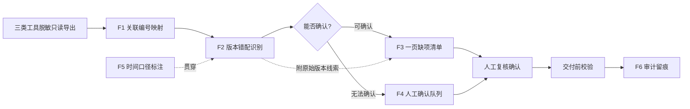

# 优先问题确认与功能方案 · 多渠道传播素材交付

> **资料性质：合成演练样本，非真实业务结论。** 本文基于上海广告有限公司「多渠道传播素材交付」案例的合成访谈与演练资料。所有优先级判断、功能设计与验收指标均为**待验证假设**，需按样本验证并交叉核实，不代表企业真实需求，不能作为实际业务指令或验收依据。

## 一、结论摘要

| 项目 | 结论 |
| --- | --- |
| **首要问题** | 版本交接与异常复核中的「版本错配」识别与人工复核（对应 REQ-1，P0） |
| **问题本质** | 渠道规格与审批版本混放、旧链接仍被引用、三类工具无统一关联编号，导致追溯靠人工比对；同一"链接失效"表象对应相反责任方向 |
| **功能方案** | 「素材包版本核对助手」——只读、单批次、人工确认的版本核对与缺项清单辅助工具 |
| **方案边界** | 不写回、不自动判定、不改原值、不自动投放；人工作为最终确认关口 |
| **首期切入点** | 单批次演练：选取含改版链接的素材包，建立编号映射，输出一页缺项清单 |
| **验收口径** | 清单可回溯到原始版本、能区分责任方向、每条附来源与人工确认痕迹 |

优先级判断遵循报告的阶段性结论：瓶颈集中在**版本交接与异常复核**，而非单纯核对工时；可追溯性与人工确认是不可逆风险底线；应先验证版本关联与缺项清单，再讨论效率指标。

---

## 二、优先问题确认

### 2.1 候选问题清单（来自 6 条需求假设）

| 编号 | 需求假设 | 优先级 | 是否首期 | 判断 |
| --- | --- | --- | --- | --- |
| REQ-1 | 版本交接与异常复核是首要瓶颈，需建立素材包关联编号与缺项清单 | P0 | ✅ **首要** | 直接命中一线最痛点，可拦截、可验证 |
| REQ-2 | 异常识别须保留人工确认与原值，系统建议不得覆盖 | P0 | 🔒 内嵌 | 贯穿性红线，作为方案的强制约束，不单列为独立功能 |
| REQ-3 | 只读集成可支撑追溯，字段口径与脱敏后关联能力待验证 | P1 | ⏸ 依赖 | 是 REQ-1 的数据前提，在方案中作为待确认项前置处理 |
| REQ-4 | 区分业务发生时间与系统接收时间，回填时间不可作发生时间 | P1 | 🔒 内嵌 | 责任判断的关键口径，内嵌为方案的数据规则 |
| REQ-5 | 跨团队口径需先对齐目标与指标，避免单一效率指标解释效果 | P1 | ⏸ 后续 | 评估口径问题，试点后做基线测量时处理 |
| REQ-6 | 试点收窄至单批次，授权确认人与留存期限需先落责任清单 | P0 | 🔒 内嵌 | 范围与合规约束，作为方案的边界条件 |

### 2.2 为什么是 REQ-1（判断依据）

从**价值、风险可逆性、可拦截性、数据可行性**四个维度比较：

| 维度 | REQ-1 的表现 | 依据 |
| --- | --- | --- |
| 业务价值 | 一线最耗时环节是核对；不同渠道规格与审批版本混放，需逐个打开确认 | [f10]、访谈 r1 |
| 风险可逆性 | 版本错配若漏判，会导致责任归错对象、错误素材对外交付，损害在交付后才可见、难撤销 | [f11] |
| 可拦截性 | 在"版本审核→交付"之间设置校验点，可在交付前拦截，拦截点明确 | 流程分析、[f24] |
| 数据可行性 | 试点有 60 份素材的可核对样本，只读导出可支撑比对 | [f02][f32][f42] |

一线原话直指该问题："麻烦在于它表面是链接失效，实际可能是改版后清单没同步，也可能是清单先发、改版后补，责任方向完全不同" [f11]。这与报告"瓶颈集中在版本交接与异常复核"的判断一致。

### 2.3 为什么其他问题不作为首期独立功能

- **REQ-2（人工确认红线）**：不是单点问题，而是所有功能必须遵守的约束。若单独做成"人工确认模块"，会与识别、清单功能割裂；应作为强制规则嵌入每个环节。
- **REQ-6（试点范围）**：是方案的前置条件而非功能。范围不定（授权确认人、留存期限未落责任清单），方案无法闭环，需先书面确认。
- **REQ-3（只读集成）**：是数据前提。脱敏后哪些字段仍可关联尚未核实，需在方案设计中作为"待确认清单"前置处理，而不是等到开发阶段。
- **REQ-5（跨团队口径）**：属效果评估问题。基线数据尚未采集，试点前应先做基线测量，不宜在首期功能中解决。
- **工时下降类效率目标**：顾明岚明确"没有基线数据，不能拍数字"，不作为首期验收指标。

### 2.4 四来源收敛状态（决定问题是否可确认）

| 来源 | 代表 | 状态 |
| --- | --- | --- |
| Buyer · 业务决策者 | 顾明岚 | 已采集目标、预算、决策权；预算口径待最终确认 |
| Operator · 一线使用者 | 林亦舟 | 已采集现场陈述与具体异常样本；仍需操作观察核实 |
| Brief · 书面需求 | — | 原文与版本待补 |
| Industry · 行业可行性 | — | 可比技术案例与本项目适用性待补 |

> 四来源中 Buyer 与 Operator 已指向同一瓶颈（版本交接与异常复核），Brief 与 Industry 仍缺失。因此优先级判断为**高置信候选**，但未完成四来源收敛，仍属待验证假设。

---

## 三、功能方案：素材包版本核对助手

### 3.1 方案定位

在"版本审核→交付"之间插入一个**只读辅助层**：把散落在三类工具中的素材包信息按统一编号关联，自动标出「版本错配」并附原始版本线索，生成一页缺项清单，所有无法确认的项进入人工队列，由授权人员做最终确认。

### 3.2 功能模块

| 模块 | 输入 | 处理 | 输出 | 关键约束 |
| --- | --- | --- | --- | --- |
| **F1 关联编号映射** | 服务台、台账、文件库的脱敏只读导出 | 为素材包建立统一关联编号，映射渠道规格、审批版本、交付清单 | 编号映射表 | 主数据归属与编号定义方待确认 [f30] |
| **F2 版本错配识别** | 改版记录、清单发出记录、原始版本 | 比对改版节点与清单发出时间；区分「版本错配 / 规格不符 / 链接失效」 | 异常类别标签 + 责任方向提示 + 原始版本线索 | 只提示、不判定、不改值 [f14] |
| **F3 一页缺项清单** | F2 异常结果 | 按缺项类型汇总，附来源位置 | 一页缺项清单（非长摘要） | 一线明确要求"一页清单 + 来源位置" [f15] |
| **F4 人工确认队列** | F2/F3 中无法确认的项 | 转人工、保留原值原行、不默认通过 | 待确认清单 + 确认痕迹 | 无法确认进队列，必要时暂停试点 [f44] |
| **F5 时间口径标注** | 各记录时间戳 | 区分业务发生时间与系统接收时间；回填时间不作发生时间 | 双时间字段 | 过期来源不得覆盖已确认新版本 [f13][f34] |
| **F6 审计留痕** | 全程访问与操作 | 记录谁查过、用哪个版本、提了什么建议、谁确认 | 访问与确认日志 | 不能只留最终摘要 [f45] |

### 3.3 数据流

### 3.4 功能边界（明确不做）

- 不写回任何源系统；写回、外部消息、执行接口均不开放 [f32]
- 不自动判定异常性质；系统建议不得覆盖原值或省略确认 [f14]
- 不自动确认、不替授权人签字；模型没有审批权限 [f22][f41]
- 不用回填时间充当发生时间 [f13]
- 不用过期来源覆盖已确认的新版本 [f34]
- 不自动投放、不连接真实媒介账户、不使用未授权素材 [f05][f52]
- 授权确认人与留存期限未落责任清单前，不纳入跨企业素材 [f43]

### 3.5 人工升级路径

| 触发情形 | 处理 | 责任人 |
| --- | --- | --- |
| 版本或关键字段无法确认 | 进入人工队列，不默认通过，必要时暂停试点 | 当班人员核对，业务负责人确认 [f14][f44][f41] |
| 责任方向 A/B 无法区分 | 保留原始版本线索，交流程协调员核对时间先后 | 唐映秋 [f20][f24] |
| 数据质量异常（重复编号、空时间、版本断链、单位差异） | 保留原行、标注疑点，不清洗后丢弃 | 秦芮 + 傅景 [f33][f44] |
| 读取失败 | 保留上次快照并标记时间，提示人工核查，不编造状态、不静默重试 | 秦芮 [f35] |

---

## 四、最小可验证试点（MVP）

| 项目 | 设定 | 来源 |
| --- | --- | --- |
| 范围 | 单批次素材包，选取含改版链接的样本 | [f05]、REQ-1 下一步 |
| 规模 | 60 份素材，渠道规格与审核版本全部匹配 | [f02][f42] |
| 资源 | 4 周、2 名业务骨干、每周 ≤4 小时 | [f03] |
| 试点侧重点 | 先验证版本关联与缺项清单，再讨论效率指标 | 报告阶段性判断 |
| 前置条件 | 授权确认人、留存期限、删除留痕方式书面确认 | REQ-6 下一步 |

**下一步验证动作**：在单批次内选取含改版链接的素材包，人工建立编号映射并输出一页缺项清单，由流程协调员核对是否覆盖全部未结项；验收以清单可回溯到原始版本为准。

---

## 五、验收指标与停止条件

### 5.1 验收硬条件

| 指标 | 标准 | 来源 |
| --- | --- | --- |
| 匹配率 | 60 份素材的渠道规格与审核版本 100% 匹配 | [f02][f42] |
| 链接提示 | 链接失效有提示 | [f02][f42] |
| 可追溯性 | 每条结果关联来源和人工复核记录 | [f42][f45] |
| 责任方向 | 清单能区分责任 A（清单未同步）/ B（改版后未补发） | [f11]、异常事件分析 |
| 原值保留 | 问题记录保留原行，改值留痕 | [f14][f33] |

### 5.2 评估指标（需先采集基线）

工时、返工次数、确认完整率三项同时看，不能用单一效率指标解释效果 [f51]；试点前做一次基线测量，双方共同确认口径 [f51]、客户简报 01。

### 5.3 停止条件

- 无法确认项未全部进入人工队列 → 暂停试点 [f44]
- 风险越线 → 审核与质量负责人保留停止试点权利 [f04]
- 授权用途不清、来源链不完整 → 不进入正式交付 [f40]

---

## 六、风险与失败控制

| 风险 | 后果 | 控制措施 | 可否撤销 |
| --- | --- | --- | --- |
| 版本错配漏判 | 错误素材交付、责任归错 | 交付前校验点 + 人工复核 [f14][f24] | 难，需前置拦截 |
| 系统建议覆盖原值 | 原始证据丢失、追溯失真 | 硬约束：保留原值原行，系统只提示 [f14][f33] | 需留痕方可 |
| 时间口径错乱 | 责任方向判断错误 | 双时间字段，回填时间不作发生时间 [f13][f34] | 可，回到原始记录核对 |
| 脱敏后无法关联 | 追溯链路断裂 | 先做字段映射演练，标记不可关联字段 | 需前置确认 |
| 越权访问跨企业素材 | 合规风险 | 授权范围外不访问，未确认前不纳入 [f41][f43] | 不可逆，需严守 |

---

## 七、待确认事项（启动前必须落责任清单）

| 事项 | 需确认内容 | 责任角色（待确认） |
| --- | --- | --- |
| 关联编号主数据 | 哪个系统做主数据、由谁定义编号 | 顾明岚 + 唐映秋 + 秦芮 |
| 脱敏关联能力 | 脱敏导出后哪些字段仍可用于关联比对 | 秦芮 + 流程侧 |
| 授权确认人 | 谁出具授权确认、谁有最终确认权 | 顾明岚 + 傅景 |
| 留存与删除 | 复核记录留存多久、删除由谁执行并留痕 | 顾明岚 + 唐映秋 + 傅景 |
| 统计口径 | 按渠道、素材份数还是交付批次统计 | 唐映秋 |
| 异常处置时限 | 进人工队列后的处置时限与触发责任人 | 傅景 + 唐映秋 |
| 自动关联能力 | 系统能否自动关联原始版本（一线明确点名与秦芮确认） | 秦芮 |
| 书面 Brief | Brief 原文与版本，补齐四来源收敛 | 顾明岚 |

---

## 八、结论

综合四来源中最强的 Buyer + Operator 证据，以及价值/风险/可拦截性/数据可行性比较，**首期优先问题确认为 REQ-1：版本交接与异常复核中的版本错配识别与人工复核**。REQ-2、REQ-4、REQ-6 作为强制约束内嵌到方案中，REQ-3 作为数据前提前置处理，REQ-5 留待基线测量阶段。功能方案以「素材包版本核对助手」为载体，只读、单批次、人工确认，先验证版本关联与一页缺项清单，再讨论效率指标。

需强调：优先级判断基于已采集的访谈事实，四来源收敛尚未完成（Brief、Industry 缺失），本方案仍是待验证假设；启动前须先落责任清单、补齐书面 Brief，并按样本验证。

---

*资料来源：discovery-report.md / .json / .csv、四份可核对资料 HTML、访谈记录 f00–f55；关联分析见 `最近一次异常事件.md` 与 `项目基准线.md`。所有优先级与指标均为合成演练中的待验证假设。*
